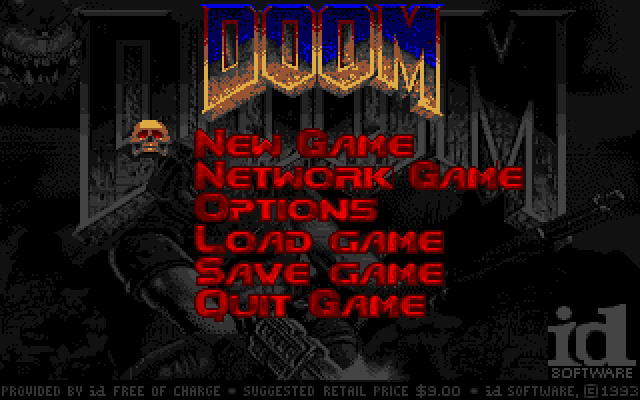
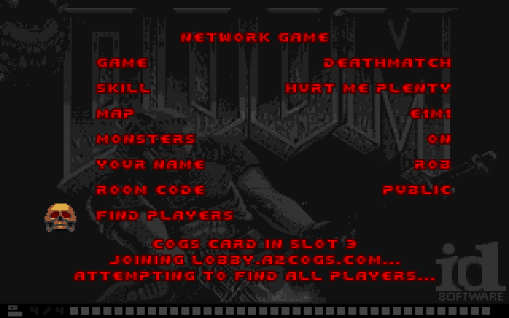
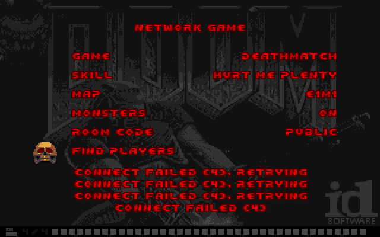
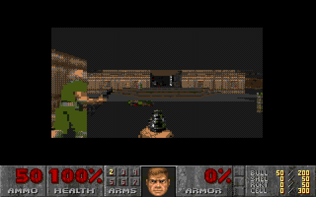
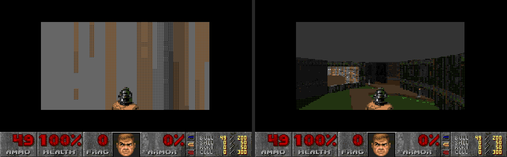
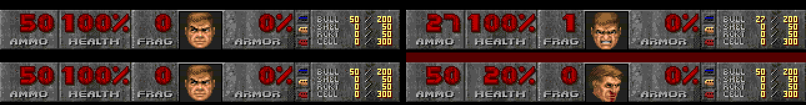
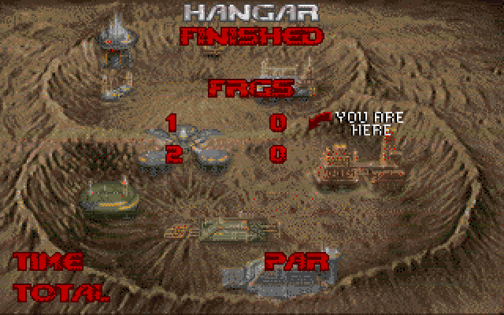

# Doom deathmatch on the Apple IIgs, over the internet

Two Apple IIgs machines, each with a [CoGS card](https://a2cogs.com) in a
slot, playing Doom against each other through lobby.a2cogs.com. Deathmatch
or cooperative, any skill, any map of the shareware episode. The 1995
feel is kept, with a `Network Game` row in Doom's own menu instead of a
setup program.

This is a branch of [Webifi's iigs-doom](https://github.com/Webifi/iigs-doom),
the 65816 port of Doom for an accelerated IIgs. His README is kept as
[README-upstream.md](README-upstream.md); everything about the engine,
the renderer and the single player game is his work and is described
there. This branch adds the second player and the network.

**Status (October 2026): played on real hardware.** A ROM 01 IIgs with
an AppleSqueezer and a ROM 3 with a TransWarp GS, each with a CoGS card
on firmware 1.36, have played deathmatch and cooperative games against
each other and against the CoGS build of MAME through the live lobby.
The image is in the CoGS disk catalog as `Doom CoGS Deathmatch`, so a
card boots it like any other disk; the file is
[disks.a2cogs.com/disks/doom-dm-hd.po](https://disks.a2cogs.com/disks/doom-dm-hd.po)
and the same image is a release asset here.



## What a player sees

Boot Doom (from the CoGS catalog, or any disk), open the menu, pick
`Network Game`.



The page is Doom's menu style, drawn in the HUD font. Left and right
change a row, up and down move the skull, Return on `FIND PLAYERS` starts
the join.

- **GAME**: Deathmatch or Cooperative.
- **SKILL**, **MAP**: the usual five skills, E1M1 to E1M9.
- **MONSTERS**: on or off (`-nomonsters`). A deathmatch has no monsters
  whatever this row says; the row counts in a cooperative game. (Doom
  itself honors `-nomonsters` in both; making the row do the same is on
  the list.)
- **YOUR NAME**: typed, up to 8 letters, for the lobby and the leaderboard.
  Blank is DOOMGUY.
- **ROOM CODE**: typed. Blank is the public queue, so whoever is waiting
  in the lobby for Doom is your opponent. A code (both players type the same
  one) makes a private room.

The join reports under the page in IPXSETUP's words. The card is found in
whatever slot it is in (7 down to 1), its network is waited for, the
lobby is joined, and the page waits for the other player for up to ten
minutes. Esc backs out at any point.

```
COGS CARD IN SLOT 5
JOINING LOBBY.A2COGS.COM...
ATTEMPTING TO FIND ALL PLAYERS...
FOUND ALL PLAYERS.
```

A failed connect retries five times, three seconds apart, and says so.



The first player in owns the page. When the second arrives, the first
one's choices go over with the go, so both machines start the same game
at the same tic whatever the other page said. Then it is Doom.





The status bar shows frags in a deathmatch (the ARMS box becomes FRAG, as
in Doom), and the intermission is the deathmatch one with a frag row per
player, under the names the players typed (the names cross with the go,
so each machine knows the other's).





At the end of each deathmatch level both machines post to the lobby's
leaderboard: frags, a win for the player with more of them, and the level
played. The board is at
[lobby.a2cogs.com/top?g=doom](https://lobby.a2cogs.com/top?g=doom).

## How it works

Doom's 1993 network model is kept. Each machine runs the whole game and
the only thing on the wire is the player's input, one 9-byte record per
tic (tic number, forward, side, turn, buttons, and a consistency word).
Each machine runs a tic only when it has both players' records for it,
so the two games stay identical. The consistency word (the low word of
the player's x, as in Doom) catches a divergence.

The 65816 port keeps one player struct in bank 0 direct page (Webifi's
design has no room for two). This branch swaps. The other player's
struct lives in a save area and is swapped in for his think, his draw
and his damage. The identity sites that assume "the player" is the one
being rendered got the swap wrappers. That is most of the diff in
`src/iigs/p_*.s`.

The card side (`src/iigs/d_net65.s`) talks to the CoGS card through its
slot registers, one `CONNECT` with the WebSocket flag to
`wss://lobby.a2cogs.com/ws/match?g=doom&v=1&n=NAME[&c=CODE]`, then
`SEND` for each record and the card's `DATA` events for the other
machine's. The lobby queues the player like its HTTP `join`, sends each
seat its number, sends `G` to both when the second arrives, and forwards
every frame between the two sockets after that. The card does TLS and
the WebSocket framing; Doom sees bytes.

Latency is the lobby's round trip through Cloudflare. On the bench, two
emulated machines on one Mac, the game holds the full 35 tics a second
through the live lobby. Two real machines play at the frame rate of the
slower one; the wire is each card's WAN link to Cloudflare and back.

A record the other machine missed (a slow level load on the card's
block driver can drop one) is asked for again by tic number and resent
from a ring of the last 16; if it cannot be recovered, or the other
machine is silent for 30 s, or the consistency words disagree, the
game stops with a message and goes back to the title instead of an
error exit. END GAME and QUIT in a net game close the socket, and the
other machine gets "the other player left the game" and returns to the
title on a key. NEW GAME is not offered during a net game.

## Building and running the bench

Everything in [BUILD.md](BUILD.md) applies. The network game is a build
option:

```sh
make NETGAME=1 LOBBY=1
```

writes `build/doom-hd.po` (and the floppy set) with the Network Game menu
pointed at the lobby. `ROOM=CODE` pre-fills the room code, `AUTOJOIN=1`
makes the game open the page and press FIND PLAYERS itself (the bench).
Without `LOBBY=1` the build talks to the local relay `tools/dmrelay.py`
on `NETHOST:NETPORT`, plain TCP, for a bench with no internet.

Two headless machines through the lobby, lockstep checked to tic 300:

```sh
make NETGAME=1 LOBBY=1 ROOM=DMBENCH AUTOJOIN=1 && LOBBY=1 tools/dm.sh
```

Two visible windows you can play in: `LOBBY=1 tools/dmshow.sh`. One seat
with screen grabs of the page: `tools/page.sh`. Both machines booting
from their emulated card as players will: `CARDBOOT=1`. The scripts need
the CoGS build of MAME (the card device and its network backend live in
the CoGS repository, `emu/mame`), the IIgs ROM in `roms/`, and the
Calypsi assembler as in BUILD.md.

## What needs doing

- The MONSTERS row in a deathmatch (see above).
- A game whose lobby room restarts mid-match ends with "lost the other
  player's moves"; reconnecting and resuming is not built.
- The frame rate is Webifi's 4 FPS on a 12 MHz accelerator; nothing here
  changes it. Both machines run at the slower machine's pace.
- Two players only. Doom allowed four; the swap model could take more
  but the lobby rooms are for two. A third player on the same room code
  opens a new room and waits for a fourth.

## Credits and license

Doom is id Software's, released under the GPL in 1997. The IIgs port is
[Webifi's](https://github.com/Webifi/iigs-doom), GPL v2 as the original.
This branch is GPL v2 as well; see [LICENSE](LICENSE). The CoGS card and
lobby are at [a2cogs.com](https://a2cogs.com). The shareware WAD is
included as upstream includes it.
